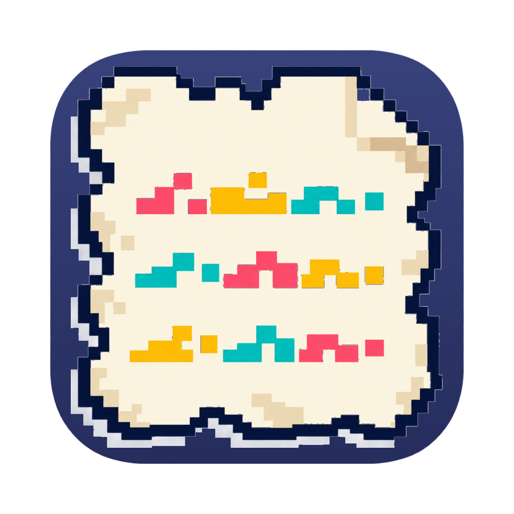
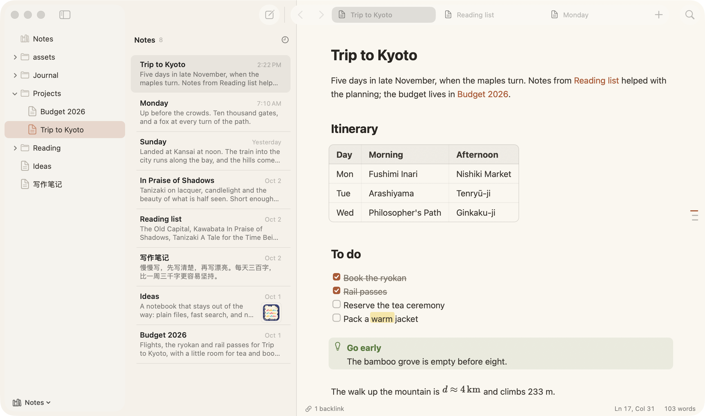

<p align="center">
  
</p>

<h1 align="center">Deckle</h1>

<p align="center">A fast, native Markdown editor.</p>

<p align="center"></p>

Deckle is written in Go and draws its own interface on the GPU with [MyGo](https://github.com/egoist/mygo): no
webview, no Electron. Notes are plain `.md` files in a folder you choose.

> **Status:** early development. Deckle runs on macOS 13 or later, on Apple silicon and Intel, and builds for
> Linux and Windows. Download it from [Releases](https://github.com/sorrycc/Deckle/releases), or build it from
> source. Installed copies update themselves.

## Features

- **Live styling.** Markdown is styled as you type, with syntax shown only around the selection.
- **Rich blocks.** Images, tables, KaTeX math and Mermaid diagrams render inline.
- **Extended syntax.** Wikilinks, footnotes, tasks, callouts, highlights, front matter and code highlighting in about 20 languages.
- **Workspaces.** A file tree, a note list with previews, and tabs with history.
- **Search and commands.** Quick open (⌘P), full-text search (⇧⌘F) and a command palette (⇧⌘P).
- **Backlinks.** Follow links with ⌘-click and see which notes link to the current one.
- **Typing helpers.** List continuation, a `/` block menu, note-name completion and image paste.
- **Themes.** Nine light and dark palettes with configurable fonts and line width.
- **Print and PDF export.** With the note's math, diagrams and callouts.
- **Chinese and Japanese.** Per-line glyph forms and separate font choices for CJK text.

See the [user guide](docs/usage.md) for details.

## Requirements

- Go 1.27 or later

## Build and run

```sh
go run ./cmd/deckle ~/Notes           # run from source, with a folder as the workspace
scripts/dev.sh ~/Notes                # Deckle Dev with live reload, with settings of its own
go tool mygo build                    # build build/darwin-arm64/Deckle.app and a disk image
go test ./...                         # the tests, headless
```

`go tool mygo build -platform linux/amd64,windows/amd64` builds for the other systems. Local builds are signed ad
hoc. `DECKLE_DATA_DIR` keeps the settings in another folder.

## Releasing

Releases are built by GitHub Actions, signed with a Developer ID and notarized for macOS, and published on GitHub
Releases with signed updates, which installed copies check daily (MyGo's updater, with delta updates).

1. Write the release's notes under `## Unreleased` in `CHANGELOG.md` and commit them.
2. Run `scripts/bump.sh <version>`, or `patch`, `minor` or `major`. It sets the version in `mygo.json`, renames
   `## Unreleased` to `## <version>`, commits and tags `v<version>`, and after asking pushes `main` and the tag.
3. The [Release workflow](.github/workflows/release.yml) builds macOS (arm64 and Intel), Windows and Linux,
   uploads them with their updates, and publishes the release.

Copies of Deckle 0.1, the AppKit app, update with Sparkle: the workflow also adds each release to the appcast at
`https://sorrycc.github.io/Deckle/appcast.xml`, so they move to this version, which takes their settings, and
from then on update with MyGo.

The workflow needs these repository secrets:

| Secret | What |
|---|---|
| `MYGO_UPDATER_PRIVATE_KEY` | `mygo-update.key` from `go tool mygo keygen`, whose public key is in `mygo.json` |
| `SPARKLE_PRIVATE_KEY` | the Sparkle key Deckle 0.1 checks updates against |
| `MACOS_CERTIFICATE_P12`, `MACOS_CERTIFICATE_PASSWORD` | the Developer ID Application certificate, as a base64 `.p12`, and its password |
| `APPLE_ID`, `APPLE_TEAM_ID`, `APPLE_APP_SPECIFIC_PASSWORD` | the Apple ID that notarizes, its team, and an app-specific password |

## Project layout

| Path | Description |
|---|---|
| `cmd/deckle/` | The app: windows, the file tree, the note list, tabs, palettes, settings, printing |
| `internal/editor/` | The editor: layout, styling, input, input methods, widgets |
| `internal/markdown/` | Markdown parsing into style spans, incremental by section, and code highlighting |
| `internal/workspace/` | Workspace indexing, watching, search and links |
| `internal/settings/` | The settings file, and reading Deckle 0.1's |
| `internal/theme/` | The themes |
| `cmd/deckle/resources/renderer/` | Bundled KaTeX and Mermaid |
| `resources/Fonts/` | Bundled LXGW WenKai Lite |

## Documentation

- [User guide](docs/usage.md)
- [Architecture](docs/architecture.md)
- [Performance](docs/performance.md)

## License

Deckle is released under the [MIT License](LICENSE).

Deckle bundles the following third-party software:

| Component | Version | License |
|---|---|---|
| [MyGo](https://github.com/egoist/mygo) | 0.5.1 | [MIT](https://github.com/egoist/mygo/blob/main/LICENSE) |
| [KaTeX](https://katex.org) | 0.16.22 | [MIT](cmd/deckle/resources/renderer/LICENSE-KaTeX.txt), © Khan Academy and other contributors |
| [Mermaid](https://mermaid.js.org) | 11.12.0 | [MIT](cmd/deckle/resources/renderer/LICENSE-Mermaid.txt), © Knut Sveidqvist |
| [goldmark](https://github.com/yuin/goldmark) | 1.7.13 | [MIT](https://github.com/yuin/goldmark/blob/master/LICENSE), © Yusuke Inuzuka |
| [LXGW WenKai Lite](https://github.com/lxgw/LxgwWenKai-Lite) | | [SIL Open Font License 1.1](resources/Fonts/OFL.txt), © LXGW and The Klee Project Authors |
